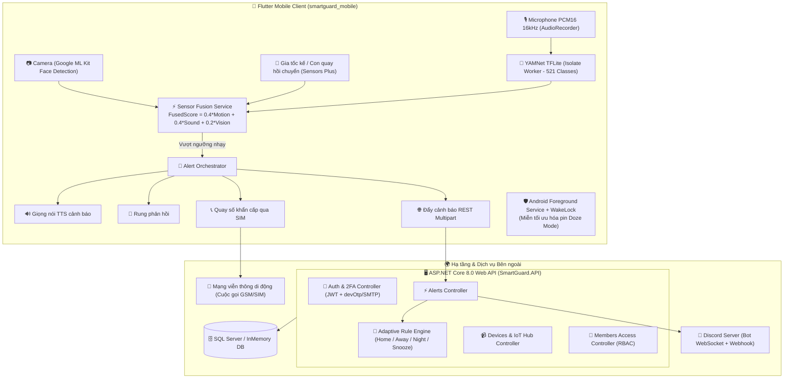

# 🐾 SMARTGUARD UNIFIED — HỆ THỐNG GIÁM SÁT AN NINH CAMERA THÔNG MINH

<div align="center">


**SmartGuard: Capybara giữ nhà, Nhà luôn an tâm!**  
*Hệ thống an ninh thông minh biến thiết bị di động thành trạm giám sát an ninh đa tầng với AI âm thanh, thị giác máy tính, cảm biến chuyển động và điều phối phản ứng khẩn cấp.*

[](backend/SmartGuard.API)
[](frontend/smartguard_mobile)
[](frontend/smartguard_mobile/assets/models)
[](frontend/smartguard_mobile)
[](tests/SmartGuard.Tests)

</div>

---

## 1. TỔNG QUAN HỆ THỐNG & KIẾN TRÚC

SmartGuard Unified là nền tảng giám sát an ninh toàn diện, kết hợp chặt chẽ giữa ứng dụng di động **Flutter** (đóng vai trò vừa là Camera AI canh gác, vừa là Trạm điều khiển di động) và máy chủ **ASP.NET Core 8.0 Web API** kết nối lưu trữ **SQL Server**, tích hợp thông báo hai chiều qua **Discord Bot** và viễn thông khẩn cấp qua thẻ **SIM**.



---

## 2. CÁC TÍNH NĂNG CỐT LÕI

### A. Nhận diện Thương hiệu & Giao diện Capybara Security
- **Triết lý thiết kế**: Chuyên nghiệp thương mại kết hợp linh vật **Capybara bảo vệ** thân thiện, tạo cảm giác an tâm cho người dùng gia đình.
- **Bảng màu chủ đạo**:
  - `Primary Navy`: `#26384F` | `Deep Navy`: `#1C293B` | `Security Blue`: `#405C83`
  - `Light Blue`: `#DCE8F3` | `Pale Blue Bg`: `#F1F5FA` | `Coral Pink`: `#FF6F59`
- **Cấu trúc 5 Tab điều hướng**:
  1. 🛡️ **Bảo vệ (Trang chủ)**: Bật/tắt trạng thái canh gác toàn hệ thống, thẻ trạng thái Camera, Pin, Lưu trữ và danh sách sự kiện gần nhất.
  2. 🕒 **Lịch sử**: Xem chi tiết dòng thời gian báo động kèm ảnh chụp bằng chứng từ hiện trường.
  3. 📷 **Camera Trực tiếp**: Giám sát khung hình thời gian thực, AI nhận diện khuôn mặt người quen/người lạ, nút chụp ảnh, đàm thoại và còi hú.
  4. 🧭 **Cảm biến IoT**: Theo dõi sóng âm thời gian thực (Microphone RMS), trạng thái mô hình YAMNet TFLite, 3 thanh trượt tinh chỉnh độ nhạy và thẻ theo dõi dịch vụ chạy ngầm.
  5. ⚙️ **Cài đặt**: Đổi IP máy chủ, kiểm tra độ trễ (Ping ms), thông tin tài khoản, cấu hình sinh trắc học và miễn trừ tối ưu pin.

---

### B. Giai đoạn 2: Dịch vụ Chạy Ngầm Bền Bỉ, Miễn Tối Ưu Pin & Gọi Điện Khẩn Cấp
1. **Android Foreground Service (`Kotlin Native`)**:
   - Chạy dịch vụ tầng nền với thông báo cố định (`Notification`), giữ `PARTIAL_WAKE_LOCK` để CPU không bị rơi vào trạng thái ngủ sâu.
   - Cấu hình `START_STICKY` và lắng nghe sự kiện `BOOT_COMPLETED` để tự động khôi phục giám sát ngay sau khi khởi động lại điện thoại hoặc bị hệ điều hành tắt giải phóng RAM.
2. **Miễn tối ưu hóa pin (Doze Mode Exemption)**:
   - Giao tiếp qua `MethodChannel`: `com.smartguard/permissions`.
   - Gọi trực tiếp `Settings.ACTION_REQUEST_IGNORE_BATTERY_OPTIMIZATIONS` kèm fallback sang cài đặt hệ thống.
   - Hộp thoại **BatteryExemptionPrompt** tự động nhắc nhở người dùng ở lần đầu vào app và thẻ **BatteryStatusCard** tự động làm mới khi quay lại ứng dụng.
3. **Quay số khẩn cấp trực tiếp qua SIM**:
   - Tích hợp `Intent.ACTION_CALL` qua kênh `com.smartguard/phone`.
   - Khi hệ thống phát hiện hành vi đột nhập cấp bách, điện thoại sẽ tự động kích hoạt cuộc gọi thoại GSM tới số điện thoại người thân đầu tiên được cài đặt trong danh bạ khẩn cấp mà không cần bấm thủ công.

---

### C. Giai đoạn 3: AI Âm Thanh Thời Gian Thực & Sensor Fusion Đa Tầng
1. **Phân loại âm thanh thời gian thực (YAMNet TFLite)**:
   - Thu âm luồng PCM 16-bit (`AudioEncoder.pcm16bits`, `16000 Hz`, Mono) liên tục qua package `record`.
   - Chuẩn hóa mẫu âm thanh Little-Endian về dải số thực `Float32 [-1.0, 1.0]`.
   - Gom bộ đệm đúng **15.600 mẫu** (`0.975 giây`) theo kích thước đầu vào chuẩn của YAMNet.
   - **Tối ưu chống nóng máy & tiết kiệm pin**:
     - *Cổng im lặng (Silence Gate)*: Bỏ qua suy luận AI khi phòng yên tĩnh (RMS < 0.015).
     - *IsolateInterpreter*: Đưa toán tử suy luận TFLite sang luồng phụ (Isolate), giải phóng 100% UI thread.
     - *Trọng số nguy cơ*: Tính điểm nguy cơ dựa trên 521 nhãn âm thanh AudioSet (ưu tiên cao cho kính vỡ, cạy cửa, tiếng la hét, còi báo động).
2. **Bộ máy hợp nhất cảm biến (Sensor Fusion Service)**:
   - Kết hợp 3 nguồn tín hiệu độc lập theo công thức trọng số:
     $$\text{FusedScore} = 0.40 \times \text{Motion} + 0.40 \times \text{Sound} + 0.20 \times \text{Vision}$$
   - **Điều phối phản ứng khẩn cấp (`AlertOrchestrator`)**:
     1. Rung cảnh báo xúc giác (`Vibration`).
     2. Cảnh báo giọng nói tiếng Việt bằng Text-To-Speech (`flutter_tts`).
     3. Đẩy thông báo khẩn lên thanh trạng thái Android Foreground Service.
     4. Gửi báo động lên Backend kèm ảnh chụp hiện trường (`POST /api/alerts/trigger`).
     5. Gọi điện thoại trực tiếp qua SIM đến danh bạ khẩn cấp.

---

### D. Smart Adaptive Security (Bảo mật Thích ứng Đa Ngữ cảnh)
Bộ máy quy tắc tự động điều chỉnh hành vi theo kịch bản sinh hoạt thực tế của gia đình:
- 🏠 **Chế độ Ở nhà (Home)**: Tự động miễn trừ/giảm thiểu cảnh báo tại các khu vực sinh hoạt (Phòng khách, Bếp), chỉ tập trung giám sát chặt chẽ cổng vào và cửa chính.
- 🚶 **Chế độ Rời nhà (Away)**: Kích hoạt toàn diện cảm biến ở mọi phân vùng, gửi cảnh báo khẩn cấp tức thì.
- 🌙 **Chế độ Ban đêm (Night)**: Tự động tăng cường độ nhạy (x1.5), bật còi hú tại chỗ ngay khi phát hiện người lạ hoặc rung lắc mạnh.
- ⏱️ **Tạm dừng / Nghỉ tạm thời (Snooze Override)**: Tạm dừng cảnh báo 15, 30, 60 phút khi có khách hoặc dọn dẹp nhà cửa.
- 🔍 **Diễn giải nguồn gốc (Explainable Alerts)**: Ghi lại nguồn gốc kích hoạt (Ví dụ: *"Kích hoạt bởi Chế độ [Ban đêm] tại [Cổng trước] (Độ nhạy x1.5)"*).

---

### E. Hệ thống Phân quyền (RBAC) & Quản lý Thiết bị / Thành viên
- **Quản trị viên (Admin)**:
  - Quản lý toàn bộ tài khoản trong hệ thống: Thêm, khóa/mở khóa tài khoản, cấp quyền.
  - Xem toàn bộ nhật ký báo động, log hệ thống và cấu hình server toàn cục.
  - Quản lý toàn bộ danh sách thiết bị IoT kết nối.
- **Chủ hộ (Owner / User)**:
  - Quản lý các thiết bị thuộc sở hữu cá nhân (Camera, Cảm biến IoT, Chuông cửa).
  - Quét tự động mDNS/IP nội bộ và thêm thiết bị theo vị trí lắp đặt (Cửa chính, Phòng khách, Ban công, v.v.).
  - Chia sẻ quyền truy cập cho người thân qua email (`/api/members/share`, `/api/members/{id}`).
  - Quản lý danh sách người thân nhận cuộc gọi / thông báo khẩn cấp.

---

### F. Backend ASP.NET Core 8.0 & An ninh Đa tầng
- **Xác thực 2 lớp (2FA)**: Kết hợp mã hóa mật khẩu `BCrypt` và mã OTP 6 số ngẫu nhiên an toàn. Hỗ trợ chế độ LAN/Offline (`devOtp` trả trực tiếp khi chạy mạng nội bộ) và chế độ trực tuyến qua Email SMTP.
- **Bảo vệ Brute-Force**: Giới hạn tần suất gửi yêu cầu (Rate Limiter: tối đa 15 requests/phút theo IP).
- **Discord Bot 2 chiều**: Tự động thông báo ảnh bằng chứng lên kênh Discord kèm nút bấm tương tác xác nhận an toàn trực tiếp từ Discord.
- **Cơ chế Chuyển đổi dự phòng (Auto-Failover)**: Frontend tự động thử lần lượt các địa chỉ dự phòng (`localhost:5235`, `127.0.0.1:5235`, `10.0.2.2:5235` và DevTunnel) khi mất kết nối.

---

## 3. CẤU TRÚC THƯ MỤC TOÀN BỘ DỰ ÁN

```
SmartGuard_Unified/
├── backend/
│   └── SmartGuard.API/
│       ├── Controllers/                    # REST API Controllers
│       │   ├── AdaptiveSecurityController.cs # Quản lý hồ sơ thích ứng (Home/Away/Night/Snooze)
│       │   ├── AdminController.cs          # Quản trị hệ thống, users, logs, RBAC
│       │   ├── AlertsController.cs         # Tiếp nhận báo động, bằng chứng, hành động
│       │   ├── AuthController.cs           # Đăng ký, đăng nhập, 2FA OTP (hỗ trợ devOtp)
│       │   ├── DevicesController.cs        # Quản lý thiết bị IoT, trạng thái Arm/Disarm
│       │   ├── ImagesController.cs         # Lưu trữ và phân phát ảnh bằng chứng
│       │   ├── MembersController.cs        # Chia sẻ thiết bị cho thành viên gia đình
│       │   └── ZonesController.cs          # Quản lý khu vực lắp đặt
│       ├── Data/
│       │   └── SmartGuardDbContext.cs      # EF Core DbContext (SQL Server / InMemory)
│       ├── DTOs/
│       │   └── AllDtos.cs                  # Record DTOs truyền nhận dữ liệu
│       ├── Models/
│       │   └── Entities.cs                 # Entities: User, Device, Alert, AdaptiveProfile...
│       ├── Services/
│       │   ├── Adaptive/                   # AdaptiveRuleEngine (Động cơ luật thích ứng)
│       │   ├── Discord/                    # DiscordBotService, IDiscordAlertService
│       │   ├── Email/                      # EmailService (SMTP Gmail + Offline LAN bypass)
│       │   └── Security/                   # TokenService (JWT, BCrypt)
│       ├── Program.cs                      # Cấu hình DI, Kestrel Port 5235, Background Tasks
│       ├── appsettings.json                # Cấu hình chuỗi kết nối DB, JWT, Discord
│       └── SmartGuard.API.csproj
│
├── frontend/
│   └── smartguard_mobile/
│       ├── android/                        # Android Native Project (Gradle 9, Kotlin 2.3)
│       │   ├── app/src/main/kotlin/.../
│       │   │   ├── MainActivity.kt         # MethodChannels (Foreground, Phone, Permissions)
│       │   │   ├── SmartGuardBootReceiver.kt
│       │   │   └── SmartGuardForegroundService.kt # Foreground Service + WakeLock
│       │   ├── app/build.gradle.kts        # Cấu hình JVM 17, NDK, SDK
│       │   └── build.gradle.kts            # Cấu hình đồng bộ JVM Target cho subprojects
│       ├── assets/
│       │   ├── images/                     # Bộ stickers & hình ảnh Capybara Mascot
│       │   └── models/                     # yamnet.tflite, yamnet_class_map.csv
│       ├── lib/
│       │   ├── core/
│       │   │   ├── api_client.dart         # HTTP Client (Failover, Auto-token, Ping test)
│       │   │   ├── app_config.dart         # Base URL, Candidate URLs, URL Normalizer
│       │   │   ├── app_theme.dart          # Hệ thống màu sắc Capybara Security UI
│       │   │   └── session_manager.dart    # Quản lý phiên làm việc bằng FlutterSecureStorage
│       │   ├── models/
│       │   │   └── models.dart             # UserModel, DeviceModel, AlertModel, MemberModel...
│       │   ├── services/
│       │   │   ├── auth_service.dart       # Xử lý luồng đăng nhập / đăng ký
│       │   │   ├── emergency_service.dart  # Danh bạ người thân khẩn cấp
│       │   │   ├── foreground_service_controller.dart # Điều khiển Service & Pin qua MethodChannel
│       │   │   ├── sensor_fusion_service.dart # Hợp nhất cảm biến & AlertOrchestrator
│       │   │   ├── sound_classifier_service.dart # AI âm thanh YAMNet TFLite (Isolate Worker)
│       │   │   └── tts_service.dart        # Phát giọng nói tiếng Việt cảnh báo
│       │   ├── screens/
│       │   │   ├── adaptive/               # AdaptiveSecurityScreen (Giao diện 3 chế độ)
│       │   │   ├── admin/                  # AdminScreen (Quản lý User, IoT, Log toàn cục)
│       │   │   ├── alerts/                 # AlertsHistoryScreen (Nhật ký sự kiện & Bằng chứng)
│       │   │   ├── auth/                   # Welcome, Login, Register, OtpScreen
│       │   │   ├── camera/                 # CameraGuardScreen (Giám sát trực tiếp, ML Kit)
│       │   │   ├── dashboard/              # DashboardScreen (Trang chủ bảo vệ)
│       │   │   ├── members/                # MembersScreen (Chia sẻ tài khoản & Gọi SIM khẩn cấp)
│       │   │   ├── motion/                 # MotionDetectionScreen (Sóng âm RMS, tinh chỉnh AI)
│       │   │   ├── settings/               # SettingsScreen (Đổi IP máy chủ, Ping test, Doze Mode)
│       │   │   ├── zones/                  # ZonesScreen (Quét tự động mDNS & phân vùng)
│       │   │   └── home_shell.dart         # Vỏ điều hướng 5 tab Capybara
│       │   ├── widgets/
│       │   │   └── battery_exemption_prompt.dart # Hộp thoại & Thẻ theo dõi Doze Mode
│       │   └── main.dart                   # Điểm khởi chạy ứng dụng
│       └── pubspec.yaml                    # dependencies: tflite_flutter, record, mlkit...
│
└── tests/
    └── SmartGuard.Tests/                   # Bộ kiểm thử tự động xUnit (10/10 Passed)
        ├── CoreTests.cs                    # Kiểm thử toàn diện Auth, Alert, Adaptive, Members
        └── SmartGuard.Tests.csproj
```

---

## 4. HƯỚNG DẪN CÀI ĐẶT & KHỞI CHẠY

### Bước 1: Chuẩn bị Môi trường
- **.NET SDK**: `8.0` hoặc mới hơn.
- **Flutter SDK**: `3.24.x` / `3.27.x` trở lên (Dart 3.5+).
- **JDK**: Java Development Kit `17` (khuyên dùng).
- **SQL Server**: LocalDB hoặc MSSQLSERVER (Nếu chưa cài đặt, dự án tự động dùng InMemory Database cho testing).

---

### Bước 2: Tải Mô hình AI Âm thanh (YAMNet)
Chạy script PowerShell để tự động tải mô hình `yamnet.tflite` (3.7 MB) và tệp nhãn 521 lớp:
```powershell
powershell -ExecutionPolicy Bypass -File .\frontend\smartguard_mobile\assets\models\download_yamnet.ps1
```

---

### Bước 3: Khởi chạy Backend (.NET 8 Web API)
```powershell
cd backend\SmartGuard.API
dotnet run
```
- Server sẽ lắng nghe tại: `http://0.0.0.0:5235` (chấp nhận kết nối từ Localhost, mạng LAN WiFi và Android Emulator).
- Giao diện tài liệu Swagger: `http://localhost:5235/swagger`
- **Tài khoản Admin mặc định**:
  - Email / Username: `admin` hoặc `admin@smartguard.local`
  - Mật khẩu: `Admin@12345`

---

### Bước 4: Khởi chạy Ứng dụng Di động (Flutter)
```powershell
cd frontend\smartguard_mobile
flutter pub get
flutter run
```

#### 💡 Cách kết nối từ Điện thoại thật (ví dụ Xiaomi `23106RN0DA`):
1. **Cách 1: Qua cáp USB ADB (Khuyên dùng - Nhanh nhất)**:
   Mở terminal gõ:
   ```powershell
   adb reverse tcp:5235 tcp:5235
   ```
   *(Điện thoại có thể kết nối thẳng đến `http://localhost:5235` của máy tính mà không cần cùng WiFi).*
2. **Cách 2: Qua mạng WiFi nội bộ (LAN)**:
   - Gõ lệnh `ipconfig` trên máy tính để lấy địa chỉ IPv4 (ví dụ `192.168.1.15`).
   - Mở app SmartGuard trên điện thoại, bấm vào biểu tượng **Bánh răng ⚙️** ở góc trên màn hình chào mừng.
   - Nhập: `http://192.168.1.15:5235` và bấm **"Kiểm tra kết nối"**.

---

## 5. KIỂM THỬ TỰ ĐỘNG (AUTOMATED TESTS)

Hệ thống đi kèm bộ kiểm thử tự động xUnit bao phủ toàn diện các kịch bản an ninh và hợp đồng kết nối giữa Backend và Frontend:

```powershell
dotnet test tests\SmartGuard.Tests\SmartGuard.Tests.csproj
```

### Danh sách 10 bài kiểm thử cốt lõi (100% Passed):
1. `Test_Password_Hashing_And_Verification`: Mã hóa và kiểm tra mật khẩu BCrypt an toàn.
2. `Test_Jwt_Token_Generation_Contains_Required_Claims`: Sinh JWT Token chứa đầy đủ định danh và Claims vai trò RBAC.
3. `Test_EndToEnd_Auth_Device_And_Alert_Flow`: Luồng khép kín từ Đăng ký, 2FA, Tạo thiết bị, Bật/Tắt canh gác đến Báo động.
4. `Test_Adaptive_Home_Mode_Suppresses_LivingRoom_Motion`: Chế độ Ở nhà ngăn chặn cảnh báo giả trong phòng khách, bảo vệ cổng chính.
5. `Test_Adaptive_Snooze_Temporarily_Suppresses_Alerts`: Chế độ Tạm dừng ngăn chặn cảnh báo trong khoảng thời gian thiết lập.
6. `Test_Adaptive_Night_Mode_Applies_High_Sensitivity`: Chế độ Ban đêm kích hoạt độ nhạy cao x1.5 và còi hú tức thì.
7. `Test_Scenario_User_Returns_Home_Transitions_From_Away_To_Home`: Chuyển đổi trạng thái linh hoạt khi chủ nhà từ ngoài trở về nhà.
8. `Test_Resilience_Invalid_Device_Returns_NotFound`: Khả năng chịu lỗi khi gọi thiết bị không tồn tại.
9. `Test_Resilience_Disarmed_Device_Skips_Trigger`: Thiết bị đã tắt canh gác không tạo bản ghi cảnh báo rác.
10. `Test_Connection_Auth_DevOtp_AlertTrigger_And_MemberShare_Contract`: Kiểm tra hợp đồng API kết nối Frontend ↔ Backend (Bypass SMTP với `devOtp`, trả về cả `id` và `alertId` cho nút tắt còi, chia sẻ và thu hồi quyền thành viên).

---

## 6. GIẤY PHÉP & THÔNG TIN DỰ ÁN

- **Dự án**: SmartGuard Unified — Hệ thống Giám sát An ninh Thông minh.
- **Môn học**: Lập trình thiết bị di động.
- **Bản quyền**: © 2026 SmartGuard Team. Đã đăng ký bản quyền toàn bộ mã nguồn và tài sản thiết kế Capybara Mascot.
